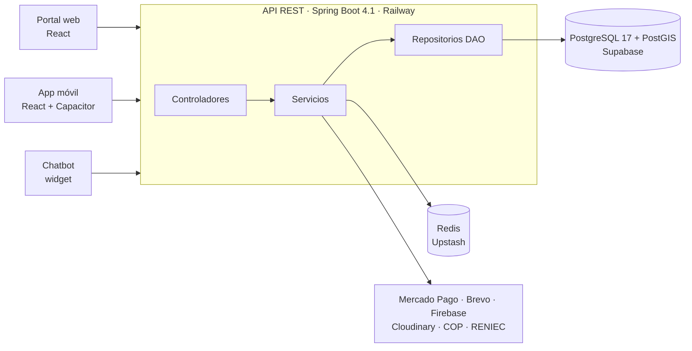

<div align="center">

# OdontoSystem

**Marketplace dental con geolocalización, reservas en tiempo real y chatbot para la provincia de Ica**

[](https://github.com/Luaaa7/OdontoSystem/actions/workflows/backend.yml)


Proyecto final · **Curso Integrador I: Sistemas - Software** · UTP · Ciclo VI · 2026

</div>

---

## ¿Qué es?

Los pacientes **encuentran odontólogos verificados cerca de ellos**, reservan un turno libre, pagan el depósito de garantía en línea y reciben recordatorios.
El odontólogo independiente gestiona su agenda, confirma citas y cobra sus liquidaciones **sin un administrador humano**: las reglas las ejecuta el backend de forma automática (arquitectura *Admin-less*).

| Búsqueda por cercanía | Reserva y reprogramación | Pago del depósito | Chatbot con contexto | Verificación COP y RENIEC |
|:---:|:---:|:---:|:---:|:---:|
| PostGIS + filtros por distrito | Sin solapes, garantizado en la BD | Mercado Pago (modo prueba) | Detección de intenciones | Tareas automáticas |

## Equipo

| Integrante | Rol |
|---|---|
| **Luana Barrientos Espinoza** | Backend, chatbot, base de datos y control de versiones |
| **Sebastián Salas Salas** | Backend: constancia de pago en PDF y avisos de citas |
| **Nicole De La Cruz Chávez** | Portal web y aplicación móvil (UX/UI) |

## Arquitectura



Arquitectura en capas (monolito modular) que aplica **MVC**, **DAO**, **TDD** y **SOLID**. El detalle está en el capítulo 10 del documento del proyecto, en [`docs/avances/`](docs/avances).

## Repositorios

| Parte | Repositorio | Tecnología |
|---|---|---|
| Backend | **este repositorio** (carpeta `backend/`) | Java 21 · Spring Boot 4.1 · Maven |
| Portal web | [Frontend_OdontoSystem](https://github.com/Nickssssss-del/Frontend_OdontoSystem) | React 19 · TypeScript |
| App móvil | [APPFRONTENDODONTO](https://github.com/Nickssssss-del/APPFRONTENDODONTO) | React 18 · TypeScript |

## Backend en cifras

| 221 | 88 | 428 | ≥ 70 % | 9 |
|:---:|:---:|:---:|:---:|:---:|
| clases Java | endpoints REST | pruebas automatizadas | cobertura (JaCoCo) | migraciones Flyway |

**Librerías de apoyo:** Google Guava · Apache POI · Apache Commons Lang3 · Logback · Apache PDFBox

## Cómo ejecutarlo

```bash
cd backend
cp .env.example .env    # completar con credenciales propias (el .env nunca se sube a Git)
./mvnw clean verify '-Dtest=!OdontoSystemApplicationTests'   # compilar y probar
./mvnw spring-boot:run  # API en http://localhost:8080
```

- Documentación de la API: `http://localhost:8080/swagger-ui.html`
- Documentación del código: `./mvnw javadoc:javadoc` → `target/reports/apidocs/index.html`

## Flujo de trabajo con Git

1. Cada funcionalidad se desarrolla en una rama con el nombre de quien la hace: `luana/…`, `sebastian/…`.
2. Cada push ejecuta las pruebas en **GitHub Actions**.
3. Los cambios llegan a `main` mediante **pull request**.
4. **Railway** despliega `main` solo si la integración continua terminó en verde.

## Estructura del repositorio

```
OdontoSystem/
├── backend/             API REST (Spring Boot)
├── docs/                avances del proyecto y documentación técnica
├── presentacion/        diapositivas de las sustentaciones
└── .github/workflows/   integración continua
```
