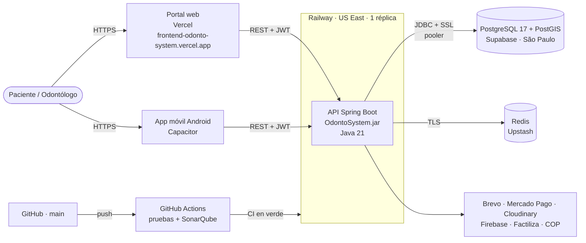

# Documentación de Despliegue — OdontoSystem

Backend: API REST en Java 21 + Spring Boot 4.1.2, construida con Maven (`pom.xml`, empaquetado `jar`).
Portal web y app móvil: repositorios de Nicole De La Cruz (ver [README](../README.md#repositorios)).

## 1. Arquitectura del sistema y entornos

### Diagrama de arquitectura de despliegue



### Entornos disponibles

| Entorno | Dónde | Para qué |
|---|---|---|
| **Desarrollo (local)** | PC de cada desarrollador, `http://localhost:8080` | Programar y correr las pruebas (`./mvnw test`). Usa su propio `.env`. |
| **Pruebas (CI)** | GitHub Actions, en cada push y pull request | Hace de entorno de preproducción: compila, corre las 428+ pruebas (las de integración contra un PostgreSQL 17 + PostGIS real en Docker/Testcontainers), mide la cobertura y analiza el código con SonarQube. No hay un servidor de staging permanente. |
| **Producción** | Railway — `https://odontosystem-production.up.railway.app` | Entorno vivo que usan el portal web y la app. Solo recibe lo que llega a `main` con el CI en verde. |

## 2. Requisitos previos

| Elemento | Versión / servicio |
|---|---|
| Plataforma del backend | Railway (PaaS), región US East, 1 réplica, construcción automática desde GitHub |
| Runtime | Java 21 (Temurin en CI; `java@21.0.13` en Railway) |
| Construcción | Maven mediante el wrapper incluido (`./mvnw`), no hace falta instalar Maven |
| Base de datos | PostgreSQL 17 + PostGIS en Supabase (conexión por *pooler*, SSL) |
| Caché / bloqueos | Redis (Upstash, TLS) |
| Contenedores | Docker, **solo** para las pruebas de integración (Testcontainers); el despliegue no usa contenedor propio |
| Portal web | Vercel (Node), repositorio Frontend_OdontoSystem |

## 3. Variables de entorno

Las credenciales reales **nunca** se suben al repositorio (`.env` está en `.gitignore`). La plantilla es
[`backend/.env.example`](../backend/.env.example). En producción se cargan en **Railway → Variables**.

| Variable | Descripción | Ejemplo de valor |
|---|---|---|
| `PORT` | Puerto HTTP (Railway lo asigna) | `8080` |
| `DB_USERNAME` / `DB_PASSWORD` | Usuario y contraseña de PostgreSQL (Supabase) | `postgres.<ref>` / `**********` |
| `DB_POOL_MAX` | Conexiones máximas del pool Hikari | `10` |
| `JWT_SECRET` | Llave para firmar los tokens de acceso (≥ 32 caracteres) | `**********` |
| `REDIS_HOST` / `REDIS_PORT` / `REDIS_PASSWORD` / `REDIS_SSL` | Conexión a Redis | `<host>.upstash.io` / `6379` / `****` / `true` |
| `CORS_ALLOWED_ORIGINS` | Orígenes que pueden llamar a la API | `https://frontend-odonto-system.vercel.app` |
| `SWAGGER_ENABLED` | Publicar Swagger (en producción: `false`) | `false` |
| `CORREO_PROVEEDOR` / `CORREO_REMITENTE` / `BREVO_API_KEY` | Envío de correos (OTP, confirmaciones, recordatorios) | `brevo` / `no-responder@…` / `****` |
| `MAIL_HOST` / `MAIL_PORT` / `MAIL_USERNAME` / `MAIL_PASSWORD` | SMTP (alternativa a Brevo) | `smtp.gmail.com` / `587` / … |
| `PAGOS_MODO` | Pasarela de pagos: `simulado` o `mercadopago` | `simulado` |
| `MERCADOPAGO_PUBLIC_KEY` / `MERCADOPAGO_ACCESS_TOKEN` / `MERCADOPAGO_PRUEBA` | Credenciales de Mercado Pago | `TEST-…` / `****` / `true` |
| `HISTORIA_CLINICA_CLAVE` | Llave AES para cifrar las historias clínicas | `**********` |
| `GOOGLE_CLIENT_ID` | Inicio de sesión con Google | `…apps.googleusercontent.com` |
| `CLOUDINARY_CLOUD_NAME` / `_API_KEY` / `_API_SECRET` | Fotos del consultorio y documentos | `odontosystem` / `****` / `****` |
| `FIREBASE_CREDENCIALES` | Notificaciones push (JSON de la cuenta de servicio) | `{…}` |
| `FACTILIZA_TOKEN` / `FACTILIZA_LIMITE_MENSUAL` | Consulta RENIEC y su cupo mensual | `****` / `100` |
| `JAVA_TOOL_OPTIONS` (solo Railway) | Límite de memoria de la JVM | `-Xmx300m` |

## 4. Paso a paso del despliegue

### Opción A — Despliegue manual con Maven (cualquier servidor con Java 21)

1. **Clonar el repositorio**
   ```bash
   git clone https://github.com/Luaaa7/OdontoSystem.git
   cd OdontoSystem/backend
   ```
2. **Instalar dependencias:** Maven las descarga solo en el paso 4 (`pom.xml`).
3. **Configurar el entorno**
   ```bash
   cp .env.example .env    # completar con los valores reales
   ```
4. **Compilar, probar y empaquetar**
   ```bash
   ./mvnw clean package    # corre las pruebas y genera target/OdontoSystem.jar (<finalName> del pom.xml)
   ```
   `OdontoSystemApplicationTests` arranca la aplicación completa y necesita la base y Redis reales; sin ellas
   (como en el CI) se excluye: `./mvnw clean package '-Dtest=!OdontoSystemApplicationTests' -Dsurefire.failIfNoSpecifiedTests=false`.
5. **Migraciones de base de datos:** no hay un paso aparte. **Flyway** aplica al arrancar las migraciones
   pendientes (`src/main/resources/db/migration`, V1–V11) y Hibernate valida el esquema (`ddl-auto=validate`).
   Si una migración falla, la aplicación no arranca.
6. **Iniciar el servicio**
   ```bash
   set -a && . ./.env && set +a                          # cargar las variables (Linux / Git Bash)
   java -jar target/OdontoSystem.jar      # API en http://localhost:8080
   ```
   En un servidor Linux se deja como servicio con `systemd` (`ExecStart=/usr/bin/java -jar /opt/odontosystem/app.jar`).

### Opción B — Despliegue en la nube (el que usa el proyecto): Railway

1. El servicio de Railway está conectado al repositorio de GitHub, rama `main`, con **Wait for CI** activado.
2. Railway detecta el proyecto Maven (`pom.xml` + `mvnw`), construye el jar con Java 21 y lo arranca con `java -jar`.
3. Antes de mandar tráfico a la versión nueva, hace el **healthcheck** en `/actuator/health`; mientras tanto la
   versión anterior sigue atendiendo (despliegue sin corte).
4. Las variables de la sección 3 se cargan en **Railway → Variables**.

## 5. Integración continua y despliegue continuo (CI/CD)

- **Herramienta:** GitHub Actions + Railway.
- **Disparador:** cada push y pull request ejecuta los workflows; cada **merge a `main`** despliega a producción.
- **Pasos del pipeline** ([`backend.yml`](../.github/workflows/backend.yml) y [`seguridad.yml`](../.github/workflows/seguridad.yml)):
  1. **Análisis del código:** SonarQube Cloud (SAST: bugs, vulnerabilidades, code smells, duplicación) con *Quality Gate*.
  2. **Pruebas:** unitarias (JUnit 5 + Mockito) e integración (Testcontainers), `./mvnw clean test`.
  3. **Cobertura:** JaCoCo; el build falla si baja del 70 % (hoy 80,4 %).
  4. **Seguridad:** matriz de control de acceso (A01), OWASP Dependency-Check y OSV-Scanner (SCA), OWASP ZAP Baseline (DAST).
  5. **Construcción y despliegue:** Railway espera el CI en verde, construye el jar y lo publica tras el healthcheck.
- **Ramas:** cada cambio se hace en una rama (`luana/…`) y entra a `main` por pull request con todos los checks en verde.
- **Respaldo:** [`backup-db.yml`](../.github/workflows/backup-db.yml) saca una copia cifrada de la base todos los domingos ([docs/respaldos.md](respaldos.md)).

## 6. Monitoreo, verificación y rollback

- **Prueba de humo (smoke test):** después de cada despliegue,
  ```bash
  curl https://odontosystem-production.up.railway.app/actuator/health   # {"status":"UP"} con HTTP 200
  ```
  Railway hace esta misma comprobación antes de activar la versión. Además, `/swagger-ui.html` y `/v3/api-docs`
  deben responder 404 en producción (prueba S-06).
- **Acceso a logs:** Railway → servicio OdontoSystem → **Deployments → View logs**.
  El nivel se ajusta con `APP_LOG_NIVEL`. Los errores 500 se registran con su traza; al cliente solo le llega un mensaje genérico.
- **Métricas:** Railway → **Metrics** (CPU, memoria, red) y SonarQube Cloud para la calidad del código.
- **Plan de retorno (rollback):**
  1. Railway → **Deployments → History** → despliegue estable anterior → **⋮ → Redeploy**.
  2. Esperar *Deployment successful* y verificar `/actuator/health` (200).
  3. Corregir el fallo en una rama, abrir PR y desplegar la corrección normalmente.
  4. Base de datos: las migraciones de Flyway solo avanzan; si una migración dañó datos, se restaura el último
     respaldo semanal con `pg_restore` ([docs/respaldos.md](respaldos.md#restaurar)) y se corrige con una migración nueva.
- **Rollback probado el 16/11/2026:** Redeploy del PR #21 y regreso al PR #22, ~1 min cada uno. Un monitor consultó
  `/actuator/health` cada 2 s durante todo el proceso: 109 consultas, 0 fallos, siempre 200 (sin tiempo fuera de servicio).
