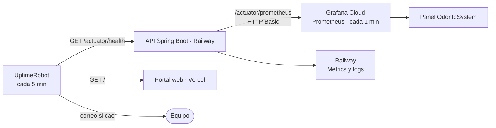

# Monitoreo de OdontoSystem

Fase de monitoreo (S16). Objetivo: detectar a tiempo caídas, lentitud y errores de la API y del portal web, y tener
datos para decidir (escalar recursos, corregir un endpoint o revertir un despliegue).

| Qué | Herramienta | Dónde se ve |
|---|---|---|
| Disponibilidad y alertas de caída | **UptimeRobot** (plan gratis) | Página de estado pública: https://stats.uptimerobot.com/L9guZyXaTg |
| Métricas de la aplicación (tráfico, tiempos, errores, JVM, base de datos) | **Spring Boot Actuator + Micrometer → Prometheus → Grafana Cloud** (plan gratis) | Panel «OdontoSystem · Monitoreo de la API» ([`monitoreo/grafana-odontosystem.json`](monitoreo/grafana-odontosystem.json)) |
| Infraestructura (CPU, RAM, red del contenedor) y logs | **Railway** → Metrics y Deployments → View logs | Panel de Railway |
| Fallos del pipeline y del respaldo | **GitHub Actions** (correo automático) | Pestaña Actions |
| Calidad del código | **SonarQube Cloud** | sonarcloud.io/project/overview?id=Luaaa7_OdontoSystem |

## 1. Métricas de rendimiento

La API publica sus métricas en `/actuator/prometheus` (Micrometer). Grafana Cloud las lee cada minuto con un usuario
propio (`METRICAS_USUARIO` / `METRICAS_PASSWORD` en Railway); sin credenciales el endpoint responde 401 y una cuenta de la
app no sirve para leerlo ([`MetricasSecurityConfig`](../backend/src/main/java/com/odontosystem/OdontoSystem/config/MetricasSecurityConfig.java), probado en `MetricasSecurityConfigTest`).

| Panel | Métrica (PromQL) | Umbral |
|---|---|---|
| API arriba | `up` | 1 = la API responde a Grafana; 0 = caída o credenciales inválidas |
| Peticiones por minuto (total y por endpoint) | `rate(http_server_requests_seconds_count[5m]) * 60` | — (uso) |
| Tiempo de respuesta p95 (total y por endpoint) | `histogram_quantile(0.95, …http_server_requests_seconds_bucket…)` | naranja ≥ 1 s · **rojo ≥ 2 s** (RNF-R1 del informe) |
| Errores 5xx | `% de respuestas con status 5..` | naranja ≥ 1 % · rojo ≥ 5 % |
| Respuestas por código | `sum by (status)` | 4xx = errores del cliente (401, 404); 5xx = del servidor |
| CPU | `process_cpu_usage`, `system_cpu_usage` | **85 %** |
| Memoria JVM | `jvm_memory_used_bytes{area="heap"}` / máx. | naranja ≥ 80 % · rojo ≥ 90 % (límite `-Xmx300m`) |
| Conexiones a la base | `hikaricp_connections_active / idle / pending / max` | «En espera» > 0 sostenido = pool corto (`DB_POOL_MAX`) |

**Lectura del 18/11/2026 (23:30, con 2 minutos de tráfico de prueba de solo lectura):** API arriba 1; 79,8 peticiones/min;
p95 1,36 s (bajo el límite de 2 s); 0 % de errores 5xx; heap 28,9 %; CPU < 1,2 %; conexiones activas ≤ 4 de 10, ninguna en espera.
Evidencia: [`monitoreo/grafana-panel.png`](monitoreo/grafana-panel.png).

## 2. Infraestructura

- **Railway → Metrics:** CPU, memoria y red del contenedor (1 réplica, US East). Complementa al panel: si la JVM está bien
  pero el contenedor no, el problema es de la plataforma.
- **Healthcheck de Railway:** antes de activar una versión nueva consulta `/actuator/health`; si no responde 200, mantiene la
  anterior ([DESPLIEGUE.md](DESPLIEGUE.md#6-monitoreo-verificación-y-rollback)).
- **Base de datos (Supabase) y Redis (Upstash):** sus paneles propios; desde la API se vigila el pool de conexiones.

## 3. Logs y trazas

- **Dónde:** Railway → servicio OdontoSystem → **Deployments → View logs** (filtro por texto, por ejemplo `ERROR`).
- **Qué se registra:** Logback; nivel con `APP_LOG_NIVEL` (INFO por defecto). Cada error 500 queda con su traza en el log y
  al cliente solo le llega un mensaje genérico (`GlobalExceptionHandler`).
- **Cómo cruzarlo con el panel:** si «Respuestas por código» muestra 500, se busca la hora en los logs de Railway y la `uri`
  en el panel «Peticiones por endpoint».

## 4. Alertas y notificaciones

| Alerta | Herramienta | Condición | Aviso |
|---|---|---|---|
| API caída | UptimeRobot (`OdontoSystem API`) | `/actuator/health` no responde 200, revisado cada 5 min | Correo |
| Web caída | UptimeRobot (`OdontoSystem Web`) | la página de inicio no responde 200 | Correo |
| Despliegue fallido | Railway | la versión nueva no pasa el healthcheck | Correo de Railway; sigue la anterior |
| Pruebas o seguridad en rojo | GitHub Actions | falla un workflow en `main` o en un PR | Correo de GitHub |
| Respaldo semanal fallido | GitHub Actions (`backup-db.yml`) | falla la copia del domingo | Correo de GitHub |
| Lentitud, errores 5xx, memoria o CPU | Panel de Grafana | umbrales de la sección 1 (colores y líneas rojas) | Revisión del panel |

**Prueba de la alerta (16/11/2026):** se creó un monitor temporal contra una ruta inexistente (`/ruta-que-no-existe`,
responde 401). UptimeRobot lo marcó **Down** y el correo «Monitor is DOWN» llegó en ~2 min con la causa (HTTP 401), la URL y la
hora (19:43:26). Luego se eliminó el monitor. Evidencias: [`uptimerobot-alerta-correo.png`](monitoreo/uptimerobot-alerta-correo.png),
[`uptimerobot-panel.png`](monitoreo/uptimerobot-panel.png), [`uptimerobot-pagina-estado.png`](monitoreo/uptimerobot-pagina-estado.png).

## 5. Qué hacer ante cada alerta

| Situación | Pasos |
|---|---|
| **API caída** (correo de UptimeRobot) | 1) Railway → Deployments: ¿el último despliegue falló o se reinicia? 2) View logs: buscar `ERROR` a esa hora. 3) Si empezó con un despliegue → **rollback** (Deployments → History → versión estable → Redeploy). 4) Si es la base o Redis, revisar Supabase/Upstash. |
| **Lentitud** (p95 ≥ 2 s) | 1) Panel «p95 por endpoint»: ¿qué ruta? 2) «Conexiones a la base»: ¿hay en espera? → subir `DB_POOL_MAX`. 3) CPU/memoria altas → escalar el servicio en Railway. 4) Si es un endpoint puntual, revisar la consulta (como DEF-05). |
| **Errores 5xx** (≥ 1 %) | 1) Panel «Respuestas por código» y «por endpoint». 2) Logs de Railway con la traza. 3) Abrir un defecto, corregir en rama + PR; si es grave, rollback mientras tanto. |
| **Memoria JVM ≥ 90 %** | Revisar si sube sin bajar (fuga) en «Memoria JVM»; reiniciar el servicio y, si se repite, subir `-Xmx` o el plan. |
| **Web caída** | Vercel → Deployments del portal (responsable: Nicole de la Cruz). |

## 6. Configuración (una sola vez)

1. **Railway → Variables:** `METRICAS_USUARIO=grafana` y `METRICAS_PASSWORD` (≥ 16 caracteres; generada con
   `openssl rand -hex 24`). Nunca en el repositorio.
2. **Grafana Cloud** (stack en US East): Connections → **Metrics Endpoint** → URL
   `https://odontosystem-production.up.railway.app/actuator/prometheus`, autenticación Basic, cada 1 min.
3. **Panel:** Dashboards → New → Import → [`monitoreo/grafana-odontosystem.json`](monitoreo/grafana-odontosystem.json) → origen de datos `…-prom`.
4. **UptimeRobot:** monitores HTTP(s) de la API (`/actuator/health`) y de la web, cada 5 min, alerta por correo; página de estado con ambos.
